# StreamGrab

A minimalist Chrome extension (Manifest V3) that detects HLS (`.m3u8`) streams and direct media files on a page, then downloads and converts them to MP4 entirely in the browser. No server, no accounts, no tracking.


<p align="center">
  
  
</p>

> Built as a personal tool and a learning project. See [Responsible use](#responsible-use) before using it.

## Features

- **Automatic detection.** Watches network responses per tab and lists HLS playlists and direct media files, with a badge count on the toolbar icon.
- **HLS downloader.** Parses master and media playlists, lets you pick a quality, then downloads segments in parallel (1 to 16 threads) with retry and backoff.
- **In-browser conversion.** Remuxes MPEG-TS segments to MP4 using mux.js. fMP4 streams (`EXT-X-MAP`) are stitched directly. A raw `.ts` output is available as a fallback.
- **Live stream recording.** Polls live playlists and records until you press Stop and save.
- **Referer and Origin handling.** Uses `declarativeNetRequest` session rules so protected CDNs accept requests as if they came from the original page.
- **Personalisation.** Light, dark, and system themes, a custom loading animation, and a picture frame for your own image or GIF (up to 30 MB).
- **Privacy by design.** Everything runs locally. Settings and images are stored in your browser only.

## How it works

```mermaid
flowchart LR
  A[Web page loads media] --> B[Service worker<br/>webRequest.onHeadersReceived]
  B -->|classify by URL and Content-Type| C[(chrome.storage.session<br/>per-tab list)]
  C --> D[Popup UI]
  D -->|Download| E[Download page]
  E --> F[DNR session rule<br/>sets Referer / Origin]
  F --> G[Playlist parser<br/>master / media / live]
  G --> H[Parallel worker pool<br/>fetch + retry]
  H --> I[mux.js<br/>TS to fMP4]
  I --> J[Blob + object URL<br/>saved to disk]
```



## Tech stack

| Area | Technology |
| --- | --- |
| Platform | Chrome Extensions, Manifest V3, service worker |
| Language | Vanilla JavaScript (ES2020), HTML5, CSS3. No framework and no build step |
| Network | `webRequest`, `declarativeNetRequest` (dynamic header modification), Fetch API with streaming `ReadableStream` |
| Media | HLS / m3u8 parsing, MPEG-TS to fragmented MP4 transmuxing with [mux.js](https://github.com/videojs/mux.js) |
| Storage | `chrome.storage.session` and `.local`, IndexedDB (Blob storage for large images), `localStorage` for flash-free theming |
| UI | CSS custom properties, `prefers-color-scheme`, `prefers-reduced-motion`, responsive CSS Grid and Flexbox, inline SVG |
| Tooling | Node and npm (dependency), Python and Pillow (icon generation), Git |

## Project structure

```
streamgrab/
├── extension/
│   ├── manifest.json         # MV3 manifest, permissions, entry points
│   ├── background.js         # Service worker: media detection and per-tab state
│   ├── popup.html / .js      # Toolbar popup listing detected media
│   ├── downloader.html / .js # Playlist parsing, worker pool, conversion, saving
│   ├── settings.html / .js   # Theme, loading animation, picture frame, defaults
│   ├── terms.html / .js      # Terms of use and acceptance gate
│   ├── common.js             # Theme and storage helpers shared by all pages
│   ├── ui.css                # Design tokens and components (light and dark)
│   ├── lib/mux.min.js        # Third-party: mux.js (Apache-2.0)
│   └── icons/                # Toolbar icons
├── docs/screenshots/         # README images
├── LICENSE
└── THIRD_PARTY_NOTICES.md
```

## Install (developer mode)

1. Clone or download this repository.
2. Open `chrome://extensions` and enable **Developer mode**.
3. Click **Load unpacked** and select the `extension/` folder.
4. Pin the extension, open a page with a video, press play, then open the popup.

## Engineering notes

A few problems that shaped the design:

- **"File wasn't available on site" errors.** Chrome's `downloads` API does not send the page's Referer or cookies, so many hosts reject the request. Downloads now run through `fetch` in the extension page, with `declarativeNetRequest` session rules (scoped by tab ID) that set Referer and Origin.
- **Service worker lifecycle.** MV3 workers are stopped when idle, so detected media is kept in `chrome.storage.session` instead of memory.
- **Large user images.** Base64 images in `storage.local` are slow and bloated, so the picture frame stores Blobs in IndexedDB, which handles 30 MB files comfortably.
- **No flash of the wrong theme.** A tiny synchronous script in `<head>` reads the saved theme from `localStorage` before first paint, while CSS variables handle the rest.
- **Bounded concurrency.** A worker pool pulls from a shared index so thread count is configurable and a stop request halts cleanly.

## Limitations

- Encrypted or DRM-protected streams are rejected by design.
- MPEG-DASH and separate HLS audio renditions are not supported yet.
- Segments are buffered in memory, so very long videos need plenty of RAM.

## Roadmap

- [ ] Merge separate HLS audio tracks
- [ ] Stream to disk with the File System Access API
- [ ] MPEG-DASH support
- [ ] Packaged build and Web Store listing

## Responsible use

StreamGrab is intended for saving content you own, that is in the public domain, or that you have permission to copy. It does not and will not decrypt or bypass DRM, paywalls, or access controls. You are responsible for complying with copyright law and the terms of the sites you use. The full terms are in `extension/terms.html` and are shown on first run.

## What I learned

- Designing and shipping a Manifest V3 extension: service workers, permissions, extension pages, and sharing state through storage.
- How HLS actually works: master and media playlists, segments, live playlists, fMP4 versus MPEG-TS.
- Browser networking limits: CORS in extension contexts, Referer and Origin behaviour, and `declarativeNetRequest`.
- Binary data in the browser: `ArrayBuffer`, `Uint8Array`, `Blob`, object URLs, and streaming reads.
- Client-side persistence trade-offs: `chrome.storage` versus `localStorage` versus IndexedDB.
- Building a themeable UI with CSS custom properties, dark mode, and accessibility basics (focus states, reduced motion, ARIA labels).
- Writing user-facing legal documents and attributing third-party licenses.

## Author

John James M. Dayap · https://Github.com/vaujx

##Contact me here!

Instagram  ·  https://www.instagram.com/johnjamesdayap/
Facebook  ·  https://www.facebook.com/Vampire.that.fears.blooooooood/
LinkedIn  ·  https://www.linkedin.com/in/john-james-dayap-83b761415/
Portfolio  ·  JohnjamesMD.vercel.app
Email  ·  Johnjamesdyp@gmail.com

## License

MIT. See [LICENSE](LICENSE). Third-party components are listed in [THIRD_PARTY_NOTICES.md](THIRD_PARTY_NOTICES.md).
